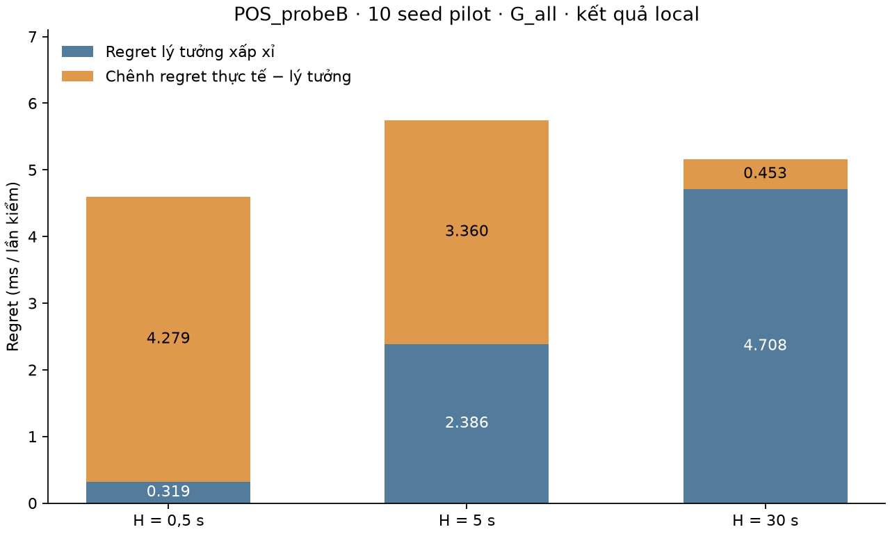

# L1.2 — Báo cáo thực hiện local (2026-10-02)

**Đã chạy n01, n01b ở ba H và n01c; tạo N1 và cập nhật N0.**

**Tái lập có sai lệch:** n01, n01c và phần sandbox thực tế khớp lesson ở độ chính xác được in. Các số sandbox lý tưởng khác bảng lesson; nguyên bản script attachment vẫn cho đúng từng bit các mảng local ở cả 30 tổ hợp H–seed.

Base commit `c41cf7ecf66d6812d13adc9efd4e50d73d406e1a`. Kết quả là minh hoạ đã biết số trước khi chạy, không phải xác nhận mù. POS_probeB, seed 9101–9110; 40.000 epoch/H; luật kỳ vọng >0, luôn ở A, không áp ngân sách harm.



## 1. Ba sandbox và đối chứng — H=0,5 s, G_all

| Sandbox | Duyệt | DN/mọi | TCN/mọi | DN/hại | TCN/lợi | Regret (ms/lần kiểm) |
|---|---:|---:|---:|---:|---:|---:|
| Biết trước | 64.31% | 0.00% | 0.00% | 0.00% | 0.00% | 0.000000 |
| Lý tưởng xấp xỉ | 64.68% | 1.81% | 1.63% | 5.71% | 2.72% | 0.319318 |
| Thực tế | 55.76% | 8.79% | 14.40% | 27.69% | 23.96% | 4.598814 |
| Luôn từ chối | 0.00% | 0.00% | 60.11% | 0.00% | 100.00% | 27.159706 |

DN = duyệt ∧ I<−ε; TCN = từ chối ∧ I>ε; ε=0,6048 ms. Vùng thờ ơ tính cả biên.

Regret = **trung bình** [max(I,0)−aI], không phải tổng chi phí; vẫn tính mất mát trong vùng thờ ơ và không phụ thuộc ε.

## 2. Phân rã theo H

| H (s) | H/τ | Regret lý tưởng (ms) | Regret thực tế (ms) | Chênh (ms) | Chênh / thực tế | Lý tưởng DN/hại |
|---|---:|---:|---:|---:|---:|---:|
| 0.5 | 0.05 | 0.319318 | 4.598814 | 4.279496 | 93.06% | 5.71% |
| 5 | 0.5 | 2.386218 | 5.746669 | 3.360452 | 58.48% | 26.79% |
| 30 | 3 | 4.708451 | 5.161522 | 0.453071 | 8.78% | 81.37% |

Phân rã là đồng nhất thức trên mẫu. Gọi hai phần là “không tránh được” và “do thông tin/mô hình” cần oracle đúng, tập thông tin/luật phù hợp và diễn giải theo kỳ vọng. Bản ideal hiện tại chỉ là xấp xỉ. Chênh regret giữa hai luật trên mẫu hữu hạn không có bảo đảm luôn không âm.

H thay đổi cả khoảng chấm, nhịp epoch và độ dài quỹ đạo. Đây không phải ba cửa sổ lồng nhau trên cùng một trace; xu hướng ba H không chứng minh regret không tránh được tăng đơn điệu với mọi H.

## 3. Đổi bộ sinh đề xuất — cùng sandbox thực tế, H=0,5 s

| Bộ sinh | Số đề xuất | Hại/đề xuất | DN/hại | TCN/lợi | P(hại/duyệt) |
|---|---:|---:|---:|---:|---:|
| G_all | 40000 | 31.76% | 27.69% | 23.96% | 15.77% |
| G_greedy | 26295 | 20.30% | 57.66% | 11.94% | 14.66% |

Tỉ lệ theo lớp cũng đổi khi thay bộ sinh. Lỗi tương quan do dùng chung telemetry là giải thích ứng viên, chưa được tách nhân quả.

## 4. Hai ví dụ xác suất và CRN

- μ=0,5, sd=3, ε=0,5 ms: P(I<−ε)=36,94%; P(I<0)=43,38%; toàn vùng thờ ơ=13,06%. Phần thờ ơ âm nằm trong I<0 chỉ là **6,44 điểm %**, không phải toàn bộ 13,06%.
- Ví dụ label shift: 10%/50% đề xuất có hại → P(hại|duyệt)=1,22%/10,00%.

| Cách ghép | TB (ms) | SD (ms, ddof=0) | Nhỏ nhất (ms) | Hiệu ứng âm |
|---|---:|---:|---:|---:|
| CRN | 8.046152 | 7.722551 | 0.535310 | 0.00% |
| Independent | 7.507848 | 9.359230 | -6.426893 | 9.33% |

n01c: 300 lần kiểm, seed 9101, nền ρ=0,85, thêm Δρ=0,1 từ đầu mô phỏng, warm-up=2 s, H=0,5 s. Đo delay probe ảo được nhận trên B, không trực tiếp đo các gói nền hay nhóm được chuyển.

CRN giữ chung arrivals nền; gói chuyển đã có trong warm-up nên workload hai nhánh ở thời điểm bắt đầu chấm có thể khác. Đây là so hai chế độ tải, **chưa là can thiệp chuyển tại t từ cùng trạng thái**. Độc lập vẫn có thể dùng ước lượng chênh kỳ vọng; từng hiệu ứng âm không phải lỗi engine. CRN không chứng minh dấu luôn dương khi hàng đợi hữu hạn có drop và điều kiện chỉ nhận probe được phục vụ.

## 5. Kiểm chứng và sai lệch so với lesson

- Neo `rhohat`, `age`, `G_true` A/B trùng từng bit với `simulate_world` cho cả 30 tổ hợp H–seed.
- Nguyên bản `n01b` trong attachment cho mảng I/real/ideal/plug trùng từng bit với dữ liệu local đã xuất.
- 264 dòng metric được kiểm từ 120.000 epoch; sáu ô cộng đúng mẫu số; regret khớp headroom−gain.
- 73 kiểm thử đạt, gồm biên ε, mẫu số theo bộ sinh, neo tuổi telemetry và CRN với can thiệp rỗng.

| Chỉ số có sai lệch | Local | Lesson | Local − lesson |
|---|---:|---:|---:|
| H0.5: ideal regret ms | 0.319318 | 0.324 | -0.004682 |
| H0.5: ideal DN|harm | 0.057143 | 0.053 | +0.004143 |
| H5: ideal regret ms | 2.386218 | 2.38 | +0.006218 |
| H5: ideal DN|harm | 0.267947 | 0.261 | +0.006947 |
| H30: ideal DN|harm | 0.813740 | 0.804 | +0.009740 |

Với W=10⁻⁶ s, `var_box` tính hiệu hai số gần nhau: Var(W)/σ²=0,999200722 thay vì gần 1. Phương sai hậu nghiệm ở H=0,5 thấp hơn giới hạn quan sát điểm OU liên tục khoảng 1,812%; ở H=5 và 30 là 0,205% và 0,022%. Đây là vấn đề ổn định số đo được, **chưa chứng minh là nguyên nhân duy nhất** của khác biệt với bảng lesson. Không có môi trường/code thực chạy của bên soạn lesson để xác định nguyên nhân.

Ngoài ra, lý tưởng dùng tích phân OU liên tục và quadrature Gauss–Hermite, còn world dùng tích phân trên lưới dt=0,05 s; không gọi đây là oracle chính xác của world rời rạc. Khoảng a là ngẫu nhiên tương lai đối với cả ideal biết lúc t; không thể quy toàn bộ ảnh hưởng a vào phần chênh regret thực tế−ideal.

## 6. Tệp và lệnh tái lập

- [N1 concepts](../../notes/novelty/N1_verdict_concepts.md), [N0 question card](../../notes/novelty/N0_question_card.md).
- Output: [n01](n01_verdict_examples_output.txt), [n01b](n01b_three_sandboxes_output.txt), [n01c](n01c_crn_two_branches_output.txt).
- CSV metrics theo seed/pooled: [H0,5](n01b_H0.5_metrics.csv), [H5](n01b_H5_metrics.csv), [H30](n01b_H30_metrics.csv).
- [Tổng hợp H](n01b_summary.csv), [300 cặp CRN](n01c_crn_trials.csv), [đối chiếu lesson](n01_lesson_comparison.csv).
- [Audit nguyên bản và số học](n01b_supplied_audit_output.txt), [CSV audit phương sai](n01b_ideal_numerical_audit.csv), [pytest](n01_tests_output.txt).
- Raw từng epoch: `results/raw/n01/n01b_H{0.5,5,30}_epochs.npz` (local, gitignored; sinh lại bằng n01b).

```bash
.venv/bin/python -m experiments.n01_verdict_examples
for hold_s in 0.5 5 30; do .venv/bin/python -m experiments.n01b_three_sandboxes --H "$hold_s"; done
.venv/bin/python -m experiments.n01c_crn_two_branches
.venv/bin/python -m experiments.n01_audit_ideal
.venv/bin/python -m pytest tests/test_n01_verdict.py tests/test_scan.py tests/test_mdk.py -q
.venv/bin/python -m experiments.n01_report
```

Có thể thêm `--lesson /đường/dẫn/attachment.txt` vào lệnh audit để kiểm lại nguyên bản Python trong lesson tin cậy. Script này thực thi đoạn mã lấy từ tệp đó. Các tham chiếu literature trong lesson chưa được kiểm lại ở lượt triển khai này.
