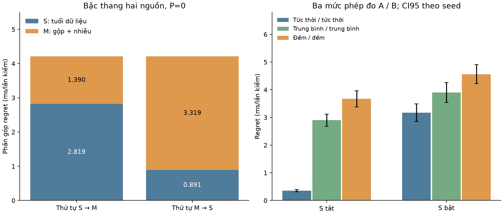

# L1.3 — Nguồn sai và phân rã: kết quả local (2026-10-02)

**Đã chạy n02 (ρ̄_B sai 0,80 và 0,70), n02b, tạo N2 và realism_sources.md.**

10 seed pilot 9101–9110, POS_probeB, H=0,5 s, a=0,05 s, G_all, luôn ở A, PSA, luật Ī>0. 40.000 epoch nền dùng chung trong n02; 8 cấu hình × 2 mức tham số = 160 đo theo seed. n02b có 120 đo theo seed (5 trường hợp của lesson + win/inst bổ sung, mỗi trường hợp 2 mức S). Đã thấy outcome trong lesson; không phải tiền đăng ký mù.



## 1. Regret factorial (ms/lần kiểm; trung bình ± nửa độ rộng CI95 t theo 10 seed)

| S M P | Twin tin B=0,80 | Twin tin B=0,70 |
|---|---:|---:|
| (0, 0, 0) | 0.352648 ± 0.042191 | 0.352648 ± 0.042191 |
| (0, 0, 1) | 0.357420 ± 0.043280 | 0.359288 ± 0.047156 |
| (0, 1, 0) | 3.671163 ± 0.291578 | 3.671163 ± 0.291578 |
| (0, 1, 1) | 3.675225 ± 0.294514 | 3.867560 ± 0.309800 |
| (1, 0, 0) | 3.171435 ± 0.315041 | 3.171435 ± 0.315041 |
| (1, 0, 1) | 3.275420 ± 0.354560 | 4.316286 ± 0.494030 |
| (1, 1, 0) | 4.561915 ± 0.342960 | 4.561915 ± 0.342960 |
| (1, 1, 1) | 4.822959 ± 0.444619 | 6.034069 ± 0.634012 |

## 2. Bậc thang, tương tác và Shapley

| Thứ tự, P=0 | S (ms) | M (ms) |
|---|---:|---:|
| S → M | 2.818787 | 1.390480 |
| M → S | 0.890752 | 3.318515 |

S×M tại P=0 = **-1.928034 ± 0.246005 ms** (hiệu của hiệu). Shapley hai nguồn: S=1.854770, M=2.354497; tổng=4.209267 ms.

Từ S=M=1, sửa riêng S cứu 0.890752 ms; sửa riêng M cứu 1.390480; sửa cả hai cứu 4.209267 ms. Sửa riêng vẫn có lợi trong ô này; không gọi là vô ích.

| Shapley ba nguồn (ms, ±CI95 paired) | B=0,80 | B=0,70 |
|---|---:|---:|
| S | 1.956966 ± 0.224823 | 2.469724 ± 0.281774 |
| M | 2.406732 ± 0.214657 | 2.495225 ± 0.196398 |
| P | 0.106613 ± 0.084754 | 0.716472 ± 0.233915 |

Shapley ba nguồn khác Shapley hai nguồn P=0. CSV còn có cả tương tác bậc ba và đủ 6 thứ tự; CI được tính sau khi lập hiệu/vector Shapley theo seed, không lấy hiệu hai CI riêng.

| Tương tác S×P, twin tin B=0,70 | Mean (ms) | CI95 half (ms) |
|---|---:|---:|
| M=0 | 1.138212 | 0.324971 |
| M=1 | 1.275757 | 0.425919 |

Chỉ sai ρ̄_B được thao tác trong P, lan vào cả tâm posterior và R ở nhánh đếm. Không suy rằng mọi sai mô hình chỉ hại khi dữ liệu cũ; sai K, dạng đường cong hoặc bỏ qua Δρ có thể hại ngay khi dữ liệu tươi.

## 3. Gộp và nhiễu: tách đúng cơ chế

| Thông tin A / B | S=0: mean ±CI95 (ms) | S=1: mean ±CI95 (ms) |
|---|---:|---:|
| inst/inst | 0.352648 ± 0.042191 | 3.171435 ± 0.315041 |
| win/win | 2.899696 ± 0.224388 | 3.899402 ± 0.359555 |
| noisy/noisy | 3.671163 ± 0.291578 | 4.561915 ± 0.342960 |
| inst/win | 2.405612 ± 0.203487 | 3.505201 ± 0.315461 |
| noisy/inst | 0.780038 ± 0.099639 | 4.168340 ± 0.362512 |
| win/inst | 0.505197 ± 0.033682 | 3.547264 ± 0.353828 |

Dòng **win/inst** được bổ sung sau khi đọc lesson để tách nhiễu A khỏi gộp A. Hiệu noisy/inst−inst/inst trong lesson gồm cả hai cơ chế, không phải riêng nhiễu.

| Hiệu ứng (giữ phần còn lại theo cấu hình chỉ định) | S=0 (ms) | S=1 (ms) |
|---|---:|---:|
| Gộp B: inst/win − inst/inst | 2.052963 ± 0.182307 | 0.333767 ± 0.136377 |
| Gộp A: win/inst − inst/inst | 0.152549 ± 0.046631 | 0.375829 ± 0.105452 |
| Nhiễu A: noisy/inst − win/inst | 0.274841 ± 0.079722 | 0.621076 ± 0.161158 |
| Gộp cả hai: win/win − inst/inst | 2.547048 ± 0.198652 | 0.727967 ± 0.130573 |
| Nhiễu cả hai: noisy/noisy − win/win | 0.771467 ± 0.091163 | 0.662514 ± 0.155860 |

Đảo thứ hạng theo S được đọc có điều kiện trên ô/mức/luật/bộ sinh đã chọn. Các công tắc không tạo một cơ chế điều khiển vật lý và chưa có nguồn cho tính thực tế của mức 30 s hay sai ρ̄.

## 4. Kiểm chứng, sai lệch và giới hạn

- 81 kiểm thử đạt; thế giới không bị sửa bởi công tắc; cùng hash giữa hai mức sai tham số; P=0 và endpoint n02b trùng từng bit.
- Audit AST: world, twin_info, regret_of (n02) và regret (n02b) giữ nguyên từ attachment. Chỉ thêm xuất số liệu, kiểm và trường hợp win/inst.
- Các nhánh đo M=1 khớp số in ở lesson; một số nhánh tức thời M=0 không khớp. Giữ nguyên W=1e-6 để tái lập; giới hạn số học/quadrature và rời rạc hoá của ideal đã ghi ở L1.2 vẫn áp dụng. Chưa có code/môi trường đã sinh bảng lesson để xác định nguyên nhân sai lệch.
- Với B, có 39237/39322 cặp epoch liên tiếp cùng r_last nhưng số đếm khác: n02 lấy u độc lập theo epoch, trong khi telemetry gốc giữ nguyên số đếm của bản tin. CRN trong n02 có hiệu lực giữa cấu hình theo coupling này, không tái lập phụ thuộc thời gian của telemetry gốc.
- Regret (1,1,0) gần n01b là kiểm mô tả, không phải neo từng bit; CI chồng lấp không chứng minh tương đương. Lịch report và các biên giữ liệu có thể cùng phân phối một epoch, nhưng quỹ đạo/RNG và tương quan nhiễu khác.
- M=0 là quan sát tại một thời điểm, M=1 là trung bình cửa sổ+nhiễu. Hai σ-algebra này không lồng nhau hoàn toàn; ở dữ liệu cũ, trung bình cửa sổ chứa thông tin quá khứ mà một điểm đơn lẻ không chứa. Đây là factorial đổi cơ chế quan sát, không tự động là giá trị thông tin Bayes tối ưu của hai tập thông tin lồng nhau.
- Trong code S tắt chỉ loại tuổi z; a luôn giữ. Có thể dùng L=z+a để mô tả gap và vẫn giữ chuẩn lý tưởng tại t. Chỉ khi quyết định loại luôn cả a khỏi phần regret nền mới cần chuẩn biết trạng thái tại t+a. Hai chuẩn khác nhau; chưa chạy chuẩn t+a ở đây.
- Giảm z hay a cùng một lượng chỉ có thể được so tương đương khi giữ cùng phân phối W/nhiễu, điều kiện dừng và luật/bộ sinh phù hợp. Đổi T_tel thường phá các điều kiện đó.

## 5. Đối chiếu số lesson

| Chỉ số không khớp ở độ chính xác đã in | Local | Lesson | Local − lesson |
|---|---:|---:|---:|
| rho0.80 (0, 0, 0) mean | 0.352648 | 0.355 | -0.002352 |
| rho0.80 (0, 0, 0) CI95 half | 0.042191 | 0.038 | +0.004191 |
| rho0.80 (0, 0, 1) mean | 0.357420 | 0.353 | +0.004420 |
| rho0.80 (0, 0, 1) CI95 half | 0.043280 | 0.039 | +0.004280 |
| rho0.80 (1, 0, 0) mean | 3.171435 | 3.156 | +0.015435 |
| rho0.80 (1, 0, 0) CI95 half | 0.315041 | 0.314 | +0.001041 |
| rho0.80 (1, 0, 1) mean | 3.275420 | 3.224 | +0.051420 |
| rho0.80 (1, 0, 1) CI95 half | 0.354560 | 0.351 | +0.003560 |
| rho0.70 interaction:S*P\|M=0 mean | 1.138212 | 0.944 | +0.194212 |
| rho0.70 interaction:S*P\|M=0 CI95 half | 0.324971 | 0.345 | -0.020029 |
| rho0.70 Shapley P | 0.716472 | 0.68 | +0.036472 |
| n02b S=0 ('inst', 'inst') | 0.352648 | 0.355 | -0.002352 |
| n02b S=1 ('inst', 'inst') | 3.171435 | 3.156 | +0.015435 |
| n02b S=0 ('inst', 'win') | 2.405612 | 2.391 | +0.014612 |
| n02b S=1 ('inst', 'win') | 3.505201 | 3.508 | -0.002799 |
| n02b S=0 ('noisy', 'inst') | 0.780038 | 0.785 | -0.004962 |
| n02b S=1 ('noisy', 'inst') | 4.168340 | 4.164 | +0.004340 |

## 6. Tệp kết quả và lệnh

- [Output factorial](n02_source_factorial_output.txt), [output tách đo](n02b_measurement_split_output.txt).
- [Seed factorial 0,80](n02_H0.5_rho0.80_seeds.csv), [seed factorial 0,70](n02_H0.5_rho0.70_seeds.csv).
- [Summary/CI 0,80](n02_H0.5_rho0.80_summary.csv), [summary/CI 0,70](n02_H0.5_rho0.70_summary.csv); `_contrasts_seeds.csv` lưu từng hiệu theo seed.
- [120 đo lồng nhau](n02b_measurement_split_seeds.csv), [hiệu gộp/nhiễu](n02b_split_contrasts.csv), [S–M khi P=0](n02_SM_P0_summary.csv).
- [So lesson](n02_lesson_comparison.csv), [audit source](n02_source_audit.json), [pytest](n02_tests_output.txt).
- [N2](../../notes/novelty/N2_error_sources.md), [realism_sources](../../notes/novelty/realism_sources.md), [bài tính](../../notes/novelty/N2_calculation_examples.md).

```bash
.venv/bin/python -m experiments.n02_source_factorial --rho_b_wrong 0.80
.venv/bin/python -m experiments.n02_source_factorial --rho_b_wrong 0.70
.venv/bin/python -m experiments.n02b_measurement_split
.venv/bin/python -m pytest tests/test_n02_sources.py tests/test_n01_verdict.py tests/test_scan.py tests/test_mdk.py -q
.venv/bin/python -m experiments.n02_report
```

Lệch kế hoạch: thêm code minh hoạ, exporter/report, kiểm thử và một trường hợp tách nhiễu A. Không sửa ndtrisk, scan, f04b hay f08. Không gán việc tự kiểm/tính giấy cho tác giả. Các quyết định N-S2/N-S3 đang để đề xuất chờ tác giả; kết quả dùng mốc t như script cung cấp.
