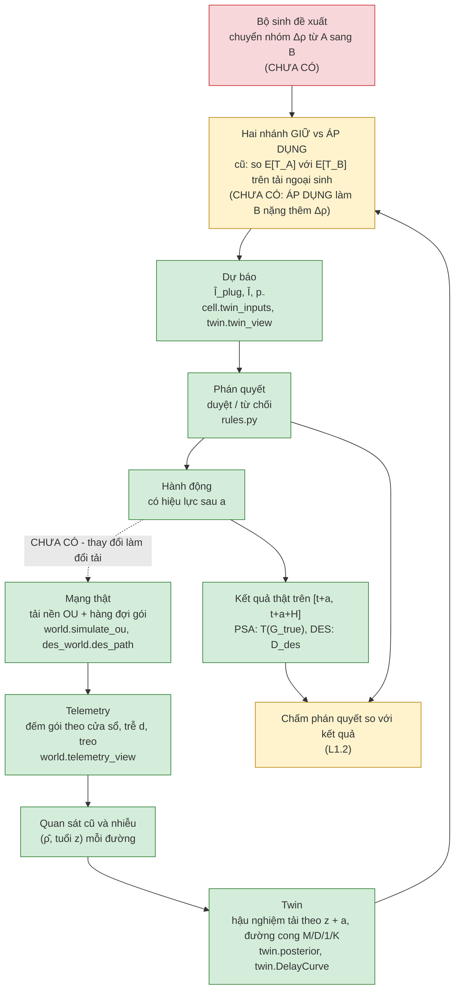

# N0 — Question card v0 (2026-10-02, nháp)

> Nguồn nháp: lesson do người dùng cung cấp (ghi Claude); Codex đưa vào repo và đối chiếu code ngày 2026-10-02.
> Chưa xác nhận tác giả đã đọc từng dòng, tự viết RQ hoặc hoàn thành bài kiểm 3 phút.
> [QUYẾT] = tác giả phải quyết · [L1.2] = lesson sau điền · [?] = chưa kiểm.
> Câu hỏi cũ (brief v2.1: ngưỡng tĩnh vs bất định) giữ nguyên làm lịch sử. File này là câu hỏi v2 (khung sandbox),
> chốt ở Gate N (L1.11).

## 1. Câu hỏi — một câu, mô tả hiện tượng

Khi một network digital twin được dùng làm sandbox để duyệt hay từ chối một đề xuất chuyển lưu lượng giữa hai đường
trước khi áp dụng, phán quyết của nó sai bao nhiêu và theo kiểu nào, phần sai đến từ điểm không hoàn hảo nào của twin,
và trong điều kiện nào phán quyết đủ tin để dùng thẳng?

**RQ diễn đạt lại — gợi ý của Codex, chưa phải lời tác giả:** Khi twin kiểm một đề xuất chuyển tải A → B, nó duyệt nhầm hoặc từ chối nhầm thường xuyên đến đâu, các sai lệch liên quan thế nào tới telemetry và mô hình, và ở điều kiện nào ta có thể tin phán quyết đó?

**RQ tác giả tự viết:** [CHỜ TÁC GIẢ].

## 2. Thành phần

| Thành phần | Định nghĩa v0 | Trạng thái |
|---|---|---|
| Đơn vị phân tích | Một lần kiểm = (thời điểm t, đề xuất, phán quyết, kết quả trên [t + a, t + a + H]) | đề xuất |
| Thay đổi được kiểm | Chuyển nhóm lưu lượng tốc độ r từ A sang B; cỡ thay đổi Δρ = r / C | Nháp tác giả chọn 2026-10-02: Δρ ∈ {0; 0,0064; 0,03; 0,1}; chốt tại Gate N |
| Trường hợp đối chứng | Δρ ≈ 0 (luồng nhỏ như repo cũ): sandbox suy biến thành so hai ước lượng trạng thái đang tồn tại | đề xuất |
| Ai đề xuất | Bộ sinh đề xuất v0 | [L1.2] |
| Phán quyết | Nhị phân duyệt / từ chối, sinh từ đầu ra twin qua một luật | đề xuất |
| Lợi ích tính cho ai | Chính: nhóm lưu lượng được chuyển. Tác động lên toàn bộ lưu lượng A/B: phần mở rộng | Nháp tác giả chọn 2026-10-02; chốt tại Gate N |
| "Đúng" nghĩa là gì | sự thật thực hiện hay kỳ vọng; ε; H | [L1.2] |
| Đối tượng được chấm | Phán quyết so với kết quả — KHÔNG phải dự báo so với kết quả | đề xuất |
| Mẫu số | Mỗi tỉ lệ ghi rõ chia cho gì; ít nhất theo lớp thật và theo lần duyệt | [L1.2] |

## 3. Không thuộc câu hỏi

1. Tìm đường tốt nhất / tối ưu định tuyến: twin chỉ chấm một đề xuất có sẵn.
2. Xây twin chính xác hơn: twin là đối tượng được chấm; điểm không hoàn hảo được vặn có chủ đích.
3. Kiểm chức năng (reachability, ACL, vòng lặp): gần như tất định, khác bản chất với kiểm hiệu năng.
4. Nhiều thay đổi đồng thời, nhiều controller, dao động toàn mạng.
5. Lỗi cấu hình, hỏng thiết bị, tấn công.

## 4. Vòng sandbox

## 5. Repo cũ so với vòng sandbox

| Hộp | Repo cũ | Ghi chú |
|---|---|---|
| Mạng thật | Có: OU (`world.simulate_ou`), hàng đợi gói (`des_world.des_path`, `f04b.workload_after`) | Hai thế giới: PSA và DES |
| Telemetry | Có (`world.telemetry_view`, `des_world.latest_available`) | cũ, nhiễu đếm, treo |
| Twin ước lượng trạng thái | Có: `posterior(ρ̂, z + a, …)` | Twin được truyền đúng tham số OU và K; PSA cùng đường cong, DES khác cơ chế (f04b). Không đồng nghĩa hậu nghiệm Gauss là chính xác với quan sát đếm Poisson |
| Hai nhánh | Suy biến: E[T_A] vs E[T_B] trên tải ngoại sinh | Chưa có nhánh làm đổi tải |
| Phán quyết | Có: luật ngưỡng (`rules.py`) | |
| Hành động | = phán quyết | |
| Kết quả | Có | Hai nhánh quan sát "miễn phí" vì luồng nhỏ; "ghép cặp" ở des_world/f04b là PSA vs DES, KHÔNG phải giữ vs áp dụng |
| Phản hồi | Không có (vòng hở) | |
| Bộ sinh đề xuất | Không có: ngầm định mọi epoch | |

## 6. Cụm từ người khác dùng (đầu vào L1.5)

Các mức kiểm dưới đây được chép từ lesson, **không phải xác nhận đọc/kiểm nguồn của Codex trong lần chạy này**. Cần kiểm tài liệu gốc ở lượt literature; chưa dùng làm kết luận novelty.

| Cụm từ | Khối | Thấy ở | Mức kiểm |
|---|---|---|---|
| what-if analysis | B | Polverini et al. NOMS 2023 (BGP); DP-DT NoF 2024 | B (abstract) |
| sandbox | B | IRTF draft -13 §8, §12 | A* (AI đọc full text 02/10; tác giả đọc lại) |
| service impact analysis | B | IRTF draft -13 §5 | A* |
| tweak and pray | vấn đề | Polverini NOMS 2023 | B |
| conflict detection (SDN applications) | B | Polverini TNSM 2026 | B |
| counterfactual what-if validation | B + C | Jimenez Agudelo 2026 (tiêu đề) | B (theo kế hoạch) |
| action certification / pre-execution check | B | OpenTwin 2026 | B (theo kế hoạch) |
| pre-deployment validation | B | [?] | — |
| trustworthy digital twin; task-centric fidelity | C | Tao, Xu, You 2026 | A (theo kế hoạch) |
| sim-to-real gap | C + D | Ruah et al. 2025 | B (theo kế hoạch) |
| exogenous trace assumption | D | CausalSim NSDI 2023 | B (theo kế hoạch) |
| configuration / change verification | LOẠI | phần lớn là kiểm chức năng → dùng để lọc ra | — |

## 7. Lịch sử sửa

- 2026-10-02 v0: nháp đầu (hỗ trợ AI). Thêm Δρ và "lợi ích tính cho ai" vì với luồng nhỏ, phán quyết sandbox
  suy biến thành quyết định đổi/giữ của khung cũ.

## 8. Trạng thái thực hiện L1.1

- Đã tạo nháp N0 và script minh hoạ; số liệu local xem [báo cáo n00](../../experiments/results/n00_report.md).
- Δρ và đối tượng hưởng lợi còn là lựa chọn thiết kế, chưa có mô phỏng can thiệp Δρ > 0.
- [ ] Tác giả tự viết câu RQ.
- [x] Tác giả chốt hai ô [QUYẾT] ở mức nháp qua phản hồi trong chat ngày 2026-10-02.
  Với C=10 Mb/s, các mức tương ứng r={0; 64; 300; 1000} kb/s; Δρ=0 là giới hạn đối chứng luồng không chiếm tải.
- [ ] Tác giả tự giải thích sơ đồ trong 3 phút và trả lời câu hỏi cuối lesson.
